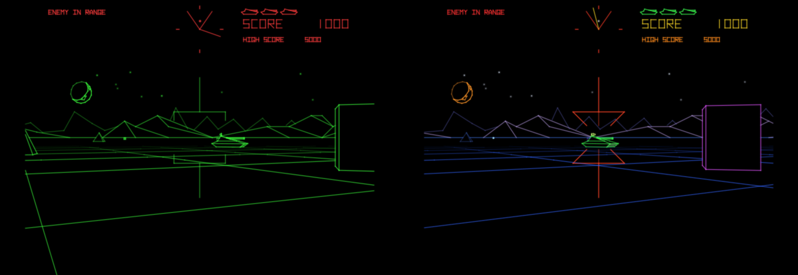
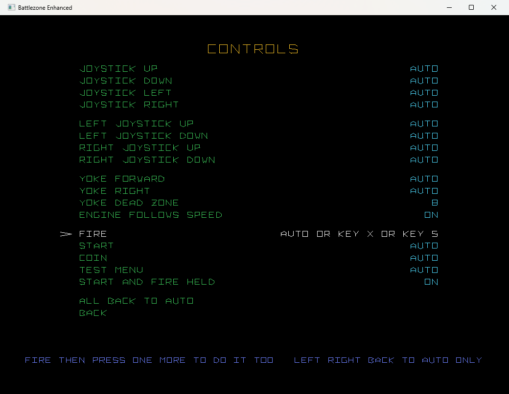

# Battlezone Enhanced

Battlezone (Atari, 1980) as a C program. It is built on the original
source code ([historicalsource/battlezone](https://github.com/historicalsource/battlezone)),
carried over to C routine by routine and checked against MAME frame by
frame. On top of the unchanged game: a smooth picture, color, a ground
grid, solid objects, new sounds and more, every one of them switchable.
Made for a vector arcade cabinet (VectorPie, a vector board over USB);
it runs in a window on a PC too.

State, known limits and what is open: [STATUS.md](STATUS.md). To carry
on with the code: [RESUME.md](RESUME.md). Building and checking:
[BUILD.md](BUILD.md). The sounds: [docs/SOUNDS.md](docs/SOUNDS.md).

## What it is

* **The game is the original, in C** (`src/game`): main loop, interrupt,
  coins, view, enemies, missile, saucer, high scores, all four languages.
  The routines are named as in the source and carry its comments. No 6502
  runs alongside.
* **Checked against MAME** (set `bzonea`): RAM, vector RAM and math box
  agree byte for byte after every frame. Figures in STATUS.md.
* **A reference in the same program**: `--original` runs the original
  program from the ROMs on a 6502 core of its own.
* **The hardware rebuilt**: math box, vector generator (with the window of
  the Battlezone board), POKEY, the discrete sounds (engine, shell,
  explosion).
* **Output through the VectorPie SDK**: a window on a PC, the vector board
  (USB-DVG) on the cabinet. On the cabinet it is installed as "Battlezone
  Enhanced" with its own marquee (`package/`, `tools/deploy.sh`,
  `tools/make_vpk.sh`).

What the port adds to the cabinet. The game's mechanics stay as they
were; the game itself knows nothing of any of it:

* **A smooth picture.** The game computes 15 frames a second. For every
  picture in between, the port puts everything that moves where it is
  between two frames and has the game's own drawing routines draw that
  picture on a copy, with a finer angle than the original
  (`render/smooth.h`; the same way as the Star Wars port).
* **Color.** Every line gets a color by what it is (`render/color.h`):
  the colors of Atari's 1980 flyer (blue, purple, futuristic; the
  default), the first palette, the cabinet's own overlay (all green, the
  top red) or white.
* **Solid objects.** What is behind an object is not drawn: back faces,
  mountains, the grid (`render/solid.h`).
* **A ground grid** in the game's perspective, coming out of the dark
  towards the horizon (`render/ground.h`).
* **New sounds.** Every one of the 15 sounds can be replaced by a WAV
  file. A pack comes with it: a heavy shot, futuristic explosions, tank
  engines with tracks, the enemy tanks' engines, a metal crash against
  obstacles. The original board sound is one switch away. List:
  [docs/SOUNDS.md](docs/SOUNDS.md).
* **Enhanced options**: sparks, stars, a second mountain row with
  parallax, a glowing volcano, a muzzle flash, stereo, quieter far away,
  ducking, the cabinet's pace and more. See "Enhanced options".
* **High scores are kept** (`save/hiscore.bin`; the same table as
  `save/highscores.txt` for the cabinet's menu and marquee, `hiscores =
  yes` in `game.ini`), all ten rows of the table the attract mode shows.
* **Three ways to drive, all at once**: one joystick, two joysticks,
  an analog yoke with any speed in between. Every action can be bound
  freely, and to several controls (up to eight, as in MAME).
* **The cabinet's volume**: the sound goes out through the SDK's stream
  (`vp_stream_play`, SDK 0.9), so the VectorPie menu's MUSIC VOLUME
  applies to it (the SDK counts a game's own stream as music).
* **A test menu on Tab** for all of this and for the cabinet's switches.

## ROMs

The game's data (vector ROM, objects, playfield, texts, tunes) is read
from your own MAME ROM set when it starts. None of it is in the project.
It needs `bzone.zip`, looked for in:

1. `--roms PATH`
2. `rom_path` in `battlezone.ini`
3. `dir_rom` in the cabinet's `advmame.rc`
4. `$BZ_ROMS`, `./roms`, `~/.advance/rom`, `~/mame/roms`

The files are recognized by their CRC; names and folders do not matter.

The source code describes **revision 1** of the program. That is MAME's
set `bzonea`; its `036414-01` is in `bzone.zip` in the folder `bzonea` and
is byte for byte the ROM file of the source repository. MAME's `bzone` is
revision 2 and differs in 149 bytes of the first program ROM (the high
score page). The C routines read only tables from ROMs both revisions
share, so they run with either set. They always behave as revision 1.

## Programs

| Program | What for |
|---|---|
| `battlezone` | the game in C |
| `battlezone --original` | the original program on the 6502 core, to compare |
| `bzcompare CAPTURE.bzcap` | checks the C routines frame by frame against a MAME capture (`--emu`: the 6502 core) |
| `bznmi CAPTURE.bzcap` | checks the interrupt routine and the power-on state in C against the original on the core |
| `bzshot` | runs the game without a screen and writes picture (SVG) and sound (WAV) |
| `bzsound` | writes each of the board's 15 sounds as a WAV to `sounds/` (docs/SOUNDS.md) |
| `test_core` | tests without ROMs: 6502 core, math box, vector generator, arithmetic macros |

Options of `battlezone`: `--roms PATH`, `--config INI`, `--original`,
`--nosound`, `--hz N`, `--dvg [PORT]`, `--window`, `--windowed`,
`--maximized`, `--vertical`. `VP_STATS=1` prints the cost per picture.

## Controls

| Action | AUTO (the default) |
|---|---|
| one joystick up / down / left / right | the arrow keys, or the first joystick's stick |
| left lever forward / back | E / D |
| right lever forward / back | I / K |
| yoke forward and right | the joystick with "yoke" in its name, else the first joystick (its two axes, with the dead zone) |
| fire | left Ctrl, the first joystick's first button, the left mouse button |
| start | 1 |
| coin | 5 (the middle coin mech, `coin2`: 6) |
| test menu | Tab (always) |
| quit | Esc |

AUTO is read directly (keyboard, joysticks, mouse buttons), the same as in
the cabinet's other vector games. Every action can be bound in the test
menu to any key, joystick button, hat way, axis or mouse button, and to
several at once (joined by "or" as in MAME: `bind_fire = auto or joy2
button 3` fires with AUTO's controls and with that one). In the menu:
START or Enter on the line, then press a control. The first one since the
cursor came to the line replaces what the action had; every further one is
added. While it waits: START or Enter leaves the line as it was, START 2
makes it NONE (nothing does the action), Delete sets it back to AUTO. Left
or right on the line switch between AUTO and NONE. One control may be
bound to several actions. The menus themselves always go by their own
controls (the arrow keys, any joystick's stick or hat, START, Enter), not
by the bindings.

Three ways to drive, all at once (since 0.1.13; before, one had to be
chosen). Whatever is plugged in works:

| Way | What it does |
|---|---|
| one joystick | digital, or the arrow keys (`p1_up`, `p1_down`, `p1_left`, `p1_right`): up is both levers forward, down both back, left and right pivot, the diagonals are the cabinet's four turns |
| two joysticks | the left and the right joystick up and down: the cabinet's two levers |
| yoke | or an analog stick (`p1_sticky`, `p1_stickx`): forward and back set the speed, any speed in between, left and right turn |

One control may belong to several of them (on the cabinet the left lever
is the arrow keys, so the one joystick too; a stick's axis is a yoke axis
and, past half way, a direction). So in every picture: if a lever of the
two joysticks is held, the levers drive. If not, the yoke drives when it
is out of its dead zone. If not, the one joystick. A digital stick that
reports axes so drives the yoke's way, the same at its ends.

With the yoke the levers can be anywhere in between. At their ends the
tank drives exactly as on the cabinet; it is never faster.

## Test menu

When initials are entered, the port replaces the line "CHANGE LETTER WITH
RIGHT HAND CONTROLLER" with one that fits the controls used last (yoke:
forward and back; one joystick: up and down). In English only, and only
in the color modes; with the overlay and white the original line stays.

Tab opens it; the game stands still meanwhile. Tab saves and goes back.
Without a keyboard: hold start and fire for two seconds, or bind a button
to it (`bind_menu`). Up and down choose a line, left and right change its
value, START (or Enter) opens a page or does the line.

| Page | What is on it |
|---|---|
| CONTROLS | every binding of all three ways to drive, the yoke's dead zone, the engine following the levers, fire, start, coin, the test menu's own key. START or Enter on a line, then a control (see "Controls"); left or right: AUTO or NONE; Delete: AUTO |
| PICTURE | smooth motion, solid objects, ground grid (each on or off), colors (flyer, classic, original, white), brightness, the page ENHANCED PICTURE, the calibration picture |
| SOUND | volume, stereo, quieter far away, enemy engines, ducking, sounds (enhanced or original), a sound test of every recording |
| GAME OPTIONS | sounds (enhanced or original), tanks, missile, bonus tank, language, coins, the cabinet's pace |
| main page | reset the high scores (START twice), save and exit |

## Enhanced options

Each can be switched on its own, in `battlezone.ini` and in the test menu.
None changes what the game computes, with one exception: `enh_tempo`
changes when it computes.

| Key | Default | What | Menu |
|---|---|---|---|
| `enh_particles` | on | sparks when the enemy or the saucer is hit, in the color of what was hit (as in Tempest 2000); the wreck always has that color | PICTURE, ENHANCED PICTURE |
| `enh_stars` | on | twinkling stars over the mountains, behind the moon and the skyline; they turn with the moon | there |
| `enh_far` | on | a second row of mountains in the back that moves half as fast as the first when turning (parallax), seen only over the first row | there |
| `enh_volcano` | on | the volcano's rocks glow as they rise and cool as they fall | there |
| `enh_flash` | on | a muzzle flash when the player fires, dust where a shell comes down | there |
| `enh_levers` | on | with the yoke: gauges for both levers in the bottom corners | there |
| `enh_stereo` | on | the enemy's shot and explosion, the missile and the saucer come from their side | SOUND |
| `enh_distance` | on | the same sounds are quieter far away (the explosion less so) | SOUND |
| `enh_enemy_engine` | on | the enemy tanks' engine, from their side, louder near, revved while driving (with the enhanced sounds; `ENEMY_ENGINE.wav`, else the player's engine, lower) | SOUND, ENEMY ENGINES |
| `enh_ducking` | on | the engines (the player's, the enemy's) 5 dB softer while the radar beep, the warning or another tune, a shot or an explosion is heard | SOUND |
| `enh_engine` | on | with the yoke: the engine revs up with how far the levers are pushed | CONTROLS |
| `enh_tempo` | off | the cabinet's pace: a frame takes as long as its 6502 took | GAME OPTIONS, CABINET PACE |
| `menu_hold` | on | start and fire held for two seconds open the test menu | CONTROLS |
| `bind_menu` | `auto` | a key or button of its own for the test menu, besides Tab | CONTROLS, TEST MENU |
| `start_lamp` | on | on the cabinet: the START lamp as the game switches it | only in the file |

## Settings

`battlezone.ini` next to the program (the defaults), your own values in
`save/battlezone.ini`.

| Key | Meaning |
|---|---|
| `rom_path` | a folder or zip with the ROMs |
| `lives` | tanks a game, 2 to 5 |
| `missile_at` | the missile from 5000, 10000, 20000 or 30000 points |
| `bonus_at` | a bonus tank at 15000, 25000 or 50000 (and 100000), 0: none |
| `language` | `english`, `german`, `french`, `spanish` |
| `coin_mode` | `free`, `2plays`, `1play`, `2coins` |
| `deadzone` | the yoke's dead zone, a fraction of its travel |
| `bind_up` ... `bind_menu` | what each action is bound to: `auto`, `none`, `key NAME`, `joyN button K`, `joyN axis K +`/`-`, `joyN hat K up`, `mouse button left`; several joined by ` or ` |
| `smooth` | 1: pictures between the frames, computed from the game's state. 2: a frame's lines moved to the next. 0: as the cabinet |
| `board_hz` | pictures a second on the vector board. Must match the board's own rate (the cabinet's menu, DVG REFRESH), or pictures are shown twice and skipped in turn. Default 50 |
| `occlusion` | 1: objects are solid. 0: see-through wire frames as on the cabinet |
| `ground_grid` | 1: a grid on the ground. 0: the bare ground of the cabinet |
| `sound_replace` | in the menu SOUNDS ENHANCED (1, the default) or ORIGINAL (0, the board's sound alone, no ducking). 1: WAV files in `sounds/` or `save/sounds/` replace sounds |
| `volume` | 0 to 1, on top of the cabinet menu's MUSIC VOLUME |
| `color_mode` | `flyer`: every line by what it is, in the flyer's colors. `color`: the same with the first palette. `overlay` (in the menu ORIGINAL): as the cabinet's overlay, the top fifth red, the rest green. `white`: one color |
| `color`, `color_top`, `color_bottom`, `overlay_split` | the colors for those (R G B) and the border |
| `brightness`, `gamma`, `floor` | how bright the lines are |
| `view_*`, `margin_*`, `flip_*` | the part of the screen and how the picture lies |

Settings of earlier versions that are gone (`controls`, `enh_haze`,
`enh_glow`, `enh_tracks`, `enh_fine_grid`, `enh_radar`, `enh_arrow`) are
read over without a word.

## Credits and legal

Enhanced by Endprodukt. Battlezone is Atari's. Program and vector ROMs are
not included; they come from your own ROM set. The project is meant for
private use.

Taken over, with credit in the source: the math box's arithmetic from
MAME's `mathbox.cpp` (Eric Smith), the vector generator's from MAME's
`avgdvg.cpp` (Mathis Rosenhauer), the values of the sound circuits from
MAME's `bzone_a.cpp` (Couriersud), all BSD-3-Clause. `third_party/miniz`
(MIT) reads the zip file. The VectorPie SDK (MIT) is used unchanged.

The sounds of the pack are recordings from freesound.org (CC0), listed in
[docs/SOUNDS.md](docs/SOUNDS.md) and `package/sounds/CREDITS.txt`; the shot
is Battle Zone II's (its license is not known).
